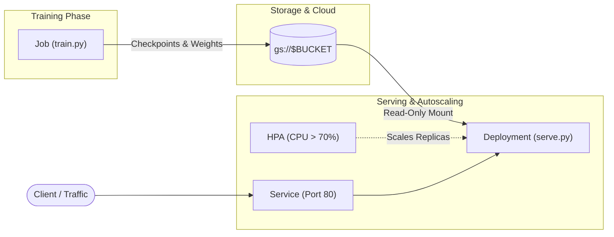

# From Checkpoint to Production on GKE (minimal, CPU-only)

[](https://cloud.google.com/kubernetes-engine)
[](https://cloud.google.com/compute)
[](https://huggingface.co/HuggingFaceTB/SmolLM2-135M-Instruct)
[](https://fastapi.tiangolo.com)
[](https://cloud.google.com/kubernetes-engine/docs/concepts/cloud-storage-fuse-csi-driver)

> Fine-tune a small LLM (**SmolLM2-135M**) as a Kubernetes **Job**, save it to a GCS bucket, and serve it with an autoscaling **Deployment**. No GPUs, no Kubeflow, just core Kubernetes.

---

### Project Structure

```text
├── app/
│   ├── Dockerfile          # Single container image for both train and serve
│   ├── requirements.txt    # Lean CPU-optimized dependencies
│   ├── train.py            # Hugging Face training script with checkpoint resumption
│   └── serve.py            # FastAPI inference server with greedy decoding
└── k8s/
    ├── train-job.yaml      # Kubernetes Job with GCS FUSE CSI mount
    └── serve.yaml          # Deployment + Service + HorizontalPodAutoscaler (HPA)
```

---

### End-to-End Architecture



---

> [!NOTE]
> **Assumes** you already have a GKE cluster with Workload Identity and the GCS FUSE CSI driver enabled. Both are on by default in Autopilot.
> ### Create Cluster & Connect if not done
```bash
# Create the GKE Autopilot cluster
gcloud container clusters create-auto ml-cluster \
  --region us-central1 \
  --project your-project-id
```
```
# Fetch credentials for kubectl
gcloud container clusters get-credentials ml-cluster \
  --region us-central1 \
  --project your-project-id
```
---

## 0. Set variables and one-time setup

```bash
export PROJECT_ID=your-project-id REGION=us-central1
export BUCKET=${PROJECT_ID}-ml
export IMAGE=${REGION}-docker.pkg.dev/${PROJECT_ID}/ml/app:v1
PROJECT_NUMBER=$(gcloud projects describe $PROJECT_ID --format='value(projectNumber)')

gcloud storage buckets create gs://$BUCKET --location=$REGION
gcloud artifacts repositories create ml --repository-format=docker --location=$REGION
kubectl create serviceaccount ml-sa

# Let the Kubernetes service account read/write the bucket (Workload Identity, no keys)
gcloud storage buckets add-iam-policy-binding gs://$BUCKET --role=roles/storage.objectUser \
  --member=principal://iam.googleapis.com/projects/$PROJECT_NUMBER/locations/global/workloadIdentityPools/$PROJECT_ID.svc.id.goog/subject/ns/default/sa/ml-sa

gcloud storage buckets update gs://${PROJECT_ID}-ml --uniform-bucket-level-access

```

---

## 1. Build the container

```bash
gcloud builds submit app --tag $IMAGE
```

---

## 2. Train (Kubernetes Job)

```bash
envsubst < k8s/train-job.yaml | kubectl apply -f -
kubectl logs -f job/train
```

`train.py` saves a checkpoint every 50 steps to `gs://$BUCKET/checkpoints`. If the pod dies, the Job restarts it and training resumes from the last checkpoint. Try it with `kubectl delete pod -l job-name=train`. When training finishes, the final model is written to `gs://$BUCKET/model`. That folder is the hand-off from training to production.

Training takes roughly 10–20 minutes on 4 vCPUs with the defaults (500 samples).

---

## 3. Serve (Deployment + Service)

```bash
envsubst < k8s/serve.yaml | kubectl apply -f -
kubectl rollout status deploy/model-server

kubectl port-forward svc/model-server 8080:80 &
curl -s localhost:8080/generate -H 'Content-Type: application/json' \
  -d '{"prompt": "What is Kubernetes?", "max_tokens": 64}'
```
| Endpoint | Method | URL | Description / Response |
| :--- | :---: | :--- | :--- |
| **Health Check** | `GET` | `http://localhost:8080/health` | Returns `{"status":"ok"}` |
| **Interactive Docs** | `GET` | `http://localhost:8080/docs` | Swagger UI to test endpoints in your browser |
| **Inference** | `POST` | `http://localhost:8080/generate` | Accepts prompt JSON and streams completion |

---

## 4. Autoscale

The HPA in `serve.yaml` adds replicas when average CPU passes 70%, up to 5. On Autopilot, new nodes appear automatically when replicas need them. Generate load and watch it scale:

```bash
for i in $(seq 1 200); do curl -s localhost:8080/generate -H 'Content-Type: application/json' \
  -d '{"prompt":"Explain autoscaling","max_tokens":64}' >/dev/null & done
kubectl get hpa model-server -w
```

---

## 5. Clean up

```bash
kubectl delete -f k8s/serve.yaml --ignore-not-found; kubectl delete job train
gcloud storage rm -r gs://$BUCKET
```

---

## 💡 Cost tips

> [!TIP]
> - **Pay for training only while it runs.** A Job's pods exit when done, so nothing keeps billing.
> - **Keep the model small.** On CPU, a 135M-parameter model trains in minutes and serves fast; larger models need GPUs.
> - **Set `minReplicas` to what you need.** The HPA scales up on load and back down to the minimum when idle.
> - **Right-size requests.** On Autopilot you're billed by pod requests, so match `cpu` and `memory` to what the pod actually uses (`kubectl top pod`).
